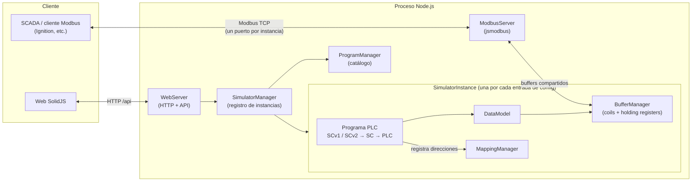
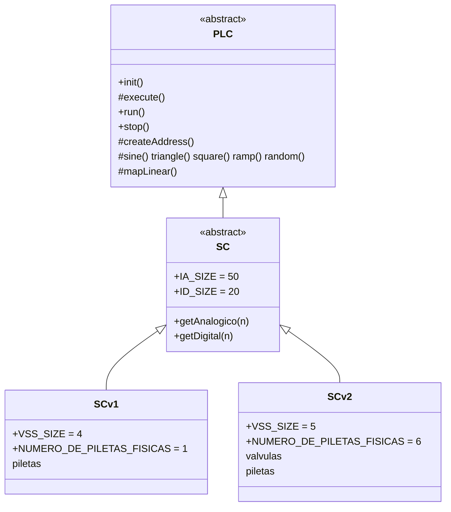
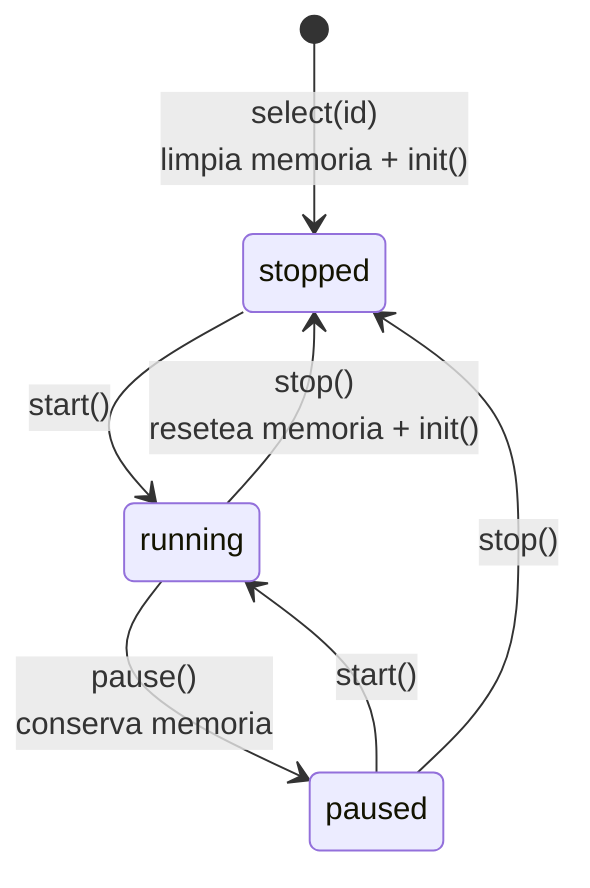

# Simulador PLC

Simulador de PLC escrito en **Node.js + TypeScript** que expone su memoria mediante
**servidores Modbus TCP** y la monitorea desde una **web en SolidJS**. Está pensado
para probar SCADAs (por ejemplo Ignition) sin hardware real: el simulador genera
señales analógicas y digitales, las escala, calcula alarmas y deja todo disponible
en registros Modbus.

## Contenido

- [Funcionalidades](#funcionalidades)
- [Requisitos y dependencias](#requisitos-y-dependencias)
- [Instalación y puesta en marcha](#instalación-y-puesta-en-marcha)
- [Configuración](#configuración)
- [Arquitectura](#arquitectura)
- [Lógica del PLC](#lógica-del-plc)
- [Mapa de memoria](#mapa-de-memoria)
- [API HTTP](#api-http)
- [Interfaz web](#interfaz-web)
- [Validación](#validación)
- [Agregar un programa nuevo](#agregar-un-programa-nuevo)
- [Limitaciones conocidas](#limitaciones-conocidas)

## Funcionalidades

- **Varias instancias de PLC en un mismo proceso**, definidas en `server-config.json`.
  Cada una tiene su propio servidor Modbus TCP (puerto exclusivo), su memoria, su mapa
  de direcciones y su programa asignado.
- **Servidor Modbus TCP esclavo** por instancia que comparte la memoria del PLC sin
  copias: lo que escribe el simulador se ve al instante desde el cliente y viceversa.
- **Ciclo de scan** configurable por instancia (250 ms por defecto) que ejecuta la
  lógica del programa.
- **50 instrumentos analógicos** con señal cruda simulada, escalado a ingeniería,
  habilitación y alarmas LL/L/H/HH con banda muerta (histéresis).
- **20 instrumentos digitales** con señal simulada, habilitación, supresión de alarma,
  5 interlocks y delays de activación/desactivación.
- **Señales por línea de pozo**: ID de pozo, diámetro de orificio de manifold y válvulas
  (4 VSS en SCv1; 2 VSS + SDV + 2 XDV en SCv2).
- **Cálculo de volumen de pileta** a partir del nivel del IA 50 (SCv1, 1 pileta) o de
  los IA 19 a 24 (SCv2, 6 piletas).
- **Catálogo de programas** (`SCv1`, `SCv2`): cada instancia arranca con el que define
  la configuración y se puede cambiar en caliente desde la web.
- **Control por instancia**: arrancar, pausar (conserva memoria) y detener (resetea memoria).
- **Monitor web** con un selector de instancias y el mapa Modbus en pestañas
  (Analógicos, Digitales, Directos), árboles por instrumento, búsqueda y actualización
  automática.

## Requisitos y dependencias

- **Node.js 18.19 o superior** (se recomienda 20 LTS) y npm.
- En Windows, escuchar en el puerto `502` puede requerir una terminal con permisos de
  administrador. Alternativa: usar puertos altos en la configuración (por ejemplo `5021`,
  `5022`...).

| Paquete | Tipo | Uso |
|---|---|---|
| `jsmodbus` | runtime | Servidor Modbus TCP sobre los buffers compartidos |
| `solid-js` | runtime | Interfaz web reactiva |
| `zod` | runtime | Validación de `server-config.json` al arrancar |
| `typescript` | dev | Compilación y chequeo de tipos |
| `tsx` | dev | Ejecución de TypeScript en desarrollo |
| `vite`, `vite-plugin-solid` | dev | Servidor de desarrollo y build de la web |
| `@types/node` | dev | Tipos de Node.js |

## Instalación y puesta en marcha

```bash
npm install
```

### Scripts disponibles

| Script | Descripción |
|---|---|
| `npm start` | Ejecuta el backend y la web previamente compilados |
| `npm run server` | Levanta el backend (Modbus + API web) con `tsx watch`, recargando ante cambios |
| `npm run web` | Levanta Vite en `http://localhost:4173` con proxy de `/api` al backend |
| `npm run build:server` | Compila el backend a `dist/` |
| `npm run build:web` | Compila la web a `dist/server/web/public` |
| `npm run build` | Compila backend y web y genera `deploy/` lista para subir |

### Desarrollo

Usar dos terminales:

```bash
npm run server   # Modbus (un puerto por instancia) y API en :8080
npm run web      # UI en http://localhost:4173
```

Vite reenvía `/api` a `http://127.0.0.1:8080`. Para apuntar a otro backend se puede
definir la variable `VITE_API_TARGET`.

> En desarrollo, `http://localhost:8080` solo sirve la API: la UI compilada no existe
> hasta ejecutar `npm run build:web`.

### Producción

```bash
npm run build
node dist/index.js
```

La web queda disponible en `http://localhost:8080` (o el `webPort` configurado) y cada
instancia atiende Modbus en su propio `port`.

### Subir la aplicación compilada a un servidor

Ejecutar `npm run build` en la PC genera esta carpeta:

```text
deploy/
├── dist/                  # Backend y web compilados
├── config/                # Configuración, incluida server-config.json
├── package.json
└── package-lock.json
```

Subir únicamente el contenido de `deploy/` a una carpeta del servidor, por ejemplo
`simulador-plc`, mediante SFTP (WinSCP). No copiar `node_modules` desde Windows.
El `package.json` de `deploy/` solo contiene `npm start`: compilar siempre desde la
raíz del proyecto, no desde la carpeta de despliegue.
En el servidor se necesita Node.js y npm, pero no las herramientas de compilación:

```bash
cd ~/simulador-plc
npm ci --omit=dev
npm start
```

Antes de iniciar, revisar `config/server-config.json`: la configuración se copia
sin modificar. Para acceder únicamente mediante un túnel SSH, usar
`"host": "127.0.0.1"` y puertos altos (por ejemplo `5021`, `5022`), reenviando por el
túnel un puerto por instancia más el `webPort`. Así se evitan permisos elevados y la
exposición directa de Modbus y la API sin autenticación.

Cada build reemplaza por completo la carpeta local `deploy/`; no guardar allí
archivos propios. Al actualizar el servidor, conservar su configuración si es
distinta de la local y reiniciar el servicio después de subir los archivos.
`npm start` ejecuta en primer plano; para mantenerlo activo al cerrar SSH y
arrancar con el sistema, configurar un servicio (por ejemplo, systemd).

### Secuencia de arranque

`src/index.ts` ejecuta, en orden:

1. Carga y valida `config/server-config.json` (si es inválido, informa cada error y termina).
2. Inicia el servidor web (API + archivos estáticos).
3. Por cada instancia, en orden: abre su servidor Modbus TCP, carga su programa y, si
   `autoStart` es `true`, lo arranca.

Si algo falla (configuración inválida, puerto ocupado, programa inexistente), el proceso
informa el error y termina con código `1`. `SIGINT`/`SIGTERM` detienen los ciclos y
cierran los puertos Modbus antes de salir.

## Configuración

Archivo `config/server-config.json`:

```json
{
    "host": "0.0.0.0",
    "webPort": 8080,
    "instances": [
        { "id": "plc-1", "name": "PLC 1", "program": "SCv1", "port": 502, "scanIntervalMs": 250, "autoStart": true },
        { "id": "plc-2", "name": "PLC 2", "program": "SCv2", "port": 503, "scanIntervalMs": 250, "autoStart": true }
    ]
}
```

| Campo | Descripción |
|---|---|
| `host` | Interfaz de escucha para Modbus y web (por defecto `0.0.0.0`) |
| `webPort` | Puerto de la API/web (por defecto `8080`) |
| `instances` | Lista de instancias (al menos una). Son fijas: para cambiarlas se edita el archivo y se reinicia |

Cada instancia:

| Campo | Descripción |
|---|---|
| `id` | Identificador único (letras, números, `-` y `_`). Se usa en la API |
| `name` | Nombre mostrado en la web (opcional; por defecto el `id`) |
| `program` | Programa inicial del catálogo (`SCv1`, `SCv2`) |
| `port` | Puerto Modbus TCP exclusivo de la instancia |
| `scanIntervalMs` | Intervalo del ciclo de scan en ms (por defecto `250`) |
| `autoStart` | Si arranca al iniciar el proceso (por defecto `true`); si es `false` queda cargada y detenida |

La validación rechaza `id` o `port` repetidos (también contra `webPort`) y campos
inválidos. El servidor Modbus responde a cualquier Unit ID.

## Arquitectura



### Capas

| Capa | Archivo | Responsabilidad |
|---|---|---|
| Bootstrap | `src/index.ts` | Orquesta el arranque |
| Configuración | `src/config/ServerConfigManager.ts` | Lee y valida (zod) el JSON de configuración |
| Memoria | `src/memory/BufferManager.ts` | Clase (una por instancia): buffers de coils (100) y holding registers (11000); lectura/escritura Int16, bit y Float32 en Big-Endian |
| Mapeo | `src/memory/MappingManager.ts` | Clase (una por instancia): registro nombre → dirección, con metadatos de instrumento para la web |
| Núcleo PLC | `src/plc/core/PLC.ts` | Ciclo de scan (`init`/`execute`), creación de direcciones y generadores de señal. Recibe su memoria y mapa por un `PlcContext` |
| Variables | `src/plc/core/DataModel.ts` | Variable con nombre, dirección, tipo y grupo; `read()`/`write()` delegan en el `BufferManager` de su instancia |
| Programas | `src/plc/programs/` | `SC` (base con analógicos y digitales), `SCv1` y `SCv2` |
| Gestión | `src/plc/managers/` | `ProgramManager` (catálogo), `SimulatorInstance` (memoria + programa + Modbus + ciclo de vida) y `SimulatorManager` (registro de instancias) |
| Modbus | `src/server/modbus/ModbusServer.ts` | Servidor TCP sobre los buffers de una instancia; se abre y cierra por instancia |
| Web backend | `src/server/web/WebServer.ts` | API REST y servido de la SPA |
| Web frontend | `src/server/web/client/` | UI SolidJS compilada con Vite |

### Jerarquía de programas



### Tipos de dirección

| Tipo | Descripción | Registros |
|---|---|---|
| `HR` | Holding Register Int16 (también se lee por bit) | 1 |
| `HRF` | Float32 IEEE 754 Big-Endian | 2 |
| `C` | Coil | 1 bit |
| `B` | Bit (lectura; escritura sin soporte) | 1 bit |

El grupo de cada variable se deduce de su nombre: `IA_*` → Analógico, `ID_*` →
Digital, `D_*` → Directo.

### Áreas Modbus

| Función | Área | Buffer |
|---|---|---|
| FC03 / FC06 / FC16 | Holding Registers | `hrBuffer` |
| FC04 | Input Registers | `hrBuffer` (misma memoria) |
| FC01 / FC05 / FC15 | Coils | `coilsBuffer` |
| FC02 | Discrete Inputs | `coilsBuffer` (misma memoria) |

## Lógica del PLC

### Ciclo de vida de una instancia



Cada instancia tiene su propio ciclo; las demás no se ven afectadas. Al seleccionar o
detener un programa se limpian la memoria y los mapeos de esa instancia y se vuelve a
ejecutar `init()`. Por eso las colecciones internas deben vaciarse al inicio de cada
`init()` para no duplicar instrumentos (`SC` ya lo hace con analógicos y digitales).

### Ciclo de scan (`SC.execute`)

Cada `SCAN_INTERVAL_MS` (250 ms) se ejecutan estas etapas:

1. **Señal cruda analógica**: cada `IA_INPUT` recibe una senoidal de período 2 h
   entre `rangoMin` y `rangoMax`, con la fase repartida entre los instrumentos.
2. **Escalado**: si el instrumento está habilitado (bit 0 de `config`), se convierte
   linealmente de rango crudo a ingeniería y se escribe en `IA_VALOR`. Si está
   deshabilitado, el valor queda en `0`.
3. **Alarmas analógicas**: para instrumentos habilitados se recalcula `IA_ESTADO`.
4. **Señal digital**: el bit 0 de `ID_VALOR` sigue una onda cuadrada (período 2 h)
   desfasada por canal.
5. **Alarmas digitales**: se actualiza el bit 1 (`Activada`) de `ID_VALOR`.

`SCv1` y `SCv2` agregan una sexta etapa: el **cálculo de volumen de pileta**.

> Los períodos de las ondas son lentos a propósito (`ANALOG_SINE_PERIOD_MS` y
> `WAVE_PERIOD_MS`, 2 h). Para ver cambios rápidos, escribir `input`/`config` por
> Modbus o reducir esas constantes.

### Instrumentos analógicos

Bits del registro `config`:

| Bit | Significado |
|---|---|
| 0 | Instrumento habilitado |
| 1 | Alarma LL habilitada |
| 2 | Alarma L habilitada |
| 3 | Alarma H habilitada |
| 4 | Alarma HH habilitada |

El registro `estado` usa las mismas posiciones (1–4) para indicar alarmas activas.

**Histéresis**: con banda muerta `DB`, una alarma baja se activa con
`valor <= SP` y se limpia cuando `valor >= SP + 2·DB`; una alarma alta se activa con
`valor >= SP` y se limpia cuando `valor <= SP − 2·DB`.
Ejemplo: SP = 50 y DB = 1 → H entra en 50 y sale en 48.

Al inicializar, `rangoMax` e `ingenieriaMax` toman valores aleatorios
(0–4000 y 0–2000), y `rangoMin`/`ingenieriaMin` valen 0.

### Instrumentos digitales

Bits del registro `config`:

| Bit | Significado |
|---|---|
| 0 | Habilitado |
| 1 | NoAlarma (suprime la alarma) |
| 2 | Alarma habilitada |
| 3–7 | Interlocks 1 a 5 |

Bits del registro `valor`: bit 0 = señal, bit 1 = alarma activada.

La alarma debe activarse cuando la señal está en 1, el instrumento y la alarma están
habilitados, no hay supresión y ningún interlock está activo. El cambio de estado se
aplica recién cuando la condición se mantiene durante `delayActivacion` o
`delayDesactivacion` (comparados contra milisegundos del reloj del ciclo).

### SCv1

- **Líneas de pozo**: 4 VSS (`activaDemanda`, `estado`), 4 IDs de pozo y 4 diámetros
  de orificio de manifold, además de la condición segura VSS y la presión de
  referencia de fuga.
- **Habilitación**: al inicializar, todos los analógicos se configuran con `config = 1`
  (habilitados, sin alarmas).
- **IDs para el SCADA**: cada analógico recibe en `id` un código que el SCADA usa para
  resolver su nombre. Se asignan en grupos de 4 (presión de pozo, presión anular,
  temperatura de pozo, presión y purga de sandtrap alta/baja, presión de sandtrap en
  manifold, presión y temperatura de DH de baja) más IDs sueltos: IA 25 (mezcla
  explosiva), IA 49 (presión gas instrumento) e IA 50 (nivel pileta 1).
- **Volumen de pileta**: hay una sola pileta. El nivel es el valor del IA 50 y su
  ingeniería máxima representa la altura máxima.

  ```text
  fracción = clamp(nivel / alturaMáxima, 0, 1)
  volumen  = área × alturaMáxima × fracción
  ```

  El área se lee de `D_AREA_PILETA_1` (valor inicial 27) y el resultado se escribe en
  `D_VOLUMEN_PILETA_1`. No hay conversión de unidades (m² × m = m³). Una configuración
  inválida (altura no positiva, área negativa o valores no finitos) lanza `RangeError`.

### SCv2

Extiende `SC` con una variante de planta con menos pozos y más piletas:

- **Válvulas**: 5 pares `activaDemanda`/`estado`: VSS 1–2 (3120–3121 / 3148–3149),
  SDV 1 (3122 / 3150), XDV 1 (3123 / 3151) y XDV 2 (3124 / 3152). La condición segura
  es `D_CONDICION_SEGURA_VALVULAS` (HR 9), con bits para VSS 1, VSS 2, SDV, XV agua
  y XV petróleo.
- **Pozos**: 2 IDs de pozo y 2 diámetros de orificio de manifold, más la presión de
  referencia de fuga.
- **Habilitación y rangos**: todos los analógicos arrancan con `config = 1` y los IA 1
  a 24 reciben rangos de ingeniería realistas (presiones, temperaturas, caudales,
  densidades y volúmenes acumulados de agua, petróleo y gas).
- **Piletas**: 6 piletas (área inicial 27); los niveles son los IA 19 a 24 (0–2.5 m)
  y el volumen se escribe en `D_VOLUMEN_PILETA_1..6` con la misma fórmula que SCv1.

## Mapa de memoria

Direcciones base para el instrumento `n` (1-based). Los `HRF` avanzan de a 2 registros.

### Analógicos (`IA_*`, n = 1..50)

| Campo | Tipo | Dirección |
|---|---|---|
| `config` | HR | `101 + (n−1)` |
| `rangoMin` | HRF | `340 + (n−1)·2` |
| `rangoMax` | HRF | `440 + (n−1)·2` |
| `ingenieriaMin` | HRF | `540 + (n−1)·2` |
| `ingenieriaMax` | HRF | `640 + (n−1)·2` |
| `setPointHh` | HRF | `740 + (n−1)·2` |
| `setPointH` | HRF | `840 + (n−1)·2` |
| `setPointL` | HRF | `940 + (n−1)·2` |
| `setPointLl` | HRF | `1040 + (n−1)·2` |
| `deadBand` | HRF | `1140 + (n−1)·2` |
| `id` | HRF | `1260 + (n−1)·2` |
| `estado` | HR | `2372 + (n−1)` |
| `valor` | HRF | `2600 + (n−1)·2` |
| `input` | HRF | `10000 + (n−1)·2` |

### Digitales (`ID_*`, n = 1..20)

| Campo | Tipo | Dirección |
|---|---|---|
| `config` | HR | `152 + (n−1)` |
| `valor` | HR | `2422 + (n−1)` |
| `delayActivacion` | HR | `2522 + (n−1)` |
| `delayDesactivacion` | HR | `2622 + (n−1)` |

### Directos (`D_*`)

| Nombre | Tipo | Dirección | Programa |
|---|---|---|---|
| `D_ESTADO_ENSAYO` | HR | 312 | SC |
| `D_TENSION_BATERIA` | HR | 2886 | SC |
| `D_CONDICION_SEGURA_VSS` | HR | 9 | SCv1 |
| `D_AREA_PILETA_1` | HRF | 294 | SCv1 |
| `D_POZO_ID_1..4` | HR | 1380–1383 | SCv1 |
| `D_DIAMETRO_ORIFICIO_MANIFOLD_1..4` | HR | 1384–1387 | SCv1 |
| `D_PRESION_REFERENCIA_FUGA` | HR | 1448 | SCv1 |
| `D_VOLUMEN_PILETA_1` | HRF | 2848 | SCv1 |
| `D_NUMERO_DE_PILETAS_FISICAS` | HR | 2866 | SCv1 |
| `D_ACTIVA_DEMANDA_VSS_1..4` | HR | 3120–3123 | SCv1 |
| `D_ESTADO_VSS_1..4` | HR | 3148–3151 | SCv1 |
| `D_CONDICION_SEGURA_VALVULAS` | HR | 9 | SCv2 |
| `D_POZO_ID_1..2`, `D_DIAMETRO_ORIFICIO_MANIFOLD_1..2` | HR | 1380–1381, 1384–1385 | SCv2 |
| `D_AREA_PILETA_1..6` | HRF | 294–304 | SCv2 |
| `D_VOLUMEN_PILETA_1..6` | HRF | 2848–2858 | SCv2 |
| `D_ACTIVA_DEMANDA_{VSS_1..2, SDV_1, XDV_1..2}` | HR | 3120–3124 | SCv2 |
| `D_ESTADO_{VSS_1..2, SDV_1, XDV_1..2}` | HR | 3148–3152 | SCv2 |

El mapa completo y en vivo se puede consultar en la web o en `GET /api/instances/:id/registers`.

## API HTTP

| Método | Ruta | Descripción |
|---|---|---|
| `GET` | `/api/instances` | Estado de todas las instancias (`{ instances: [...] }`) |
| `GET` | `/api/instances/:id` | Estado de una instancia y catálogo de programas |
| `POST` | `/api/instances/:id` | Acción de control sobre la instancia |
| `GET` | `/api/instances/:id/registers` | Mapeos de la instancia con su valor actual |

Un `:id` inexistente responde `404`. Cada fila de `/registers` incluye `address`, `type`,
`name`, `group`, `value` (redondeado a 3 decimales) y, para instrumentos, un objeto
`instrument` con `number`, `field`, y opcionalmente `alarmBits` (analógicos) o `bits`
(digitales). La web usa estos metadatos para armar los árboles sin interpretar nombres.

Body de `POST /api/instances/:id` (`id` es el id del **programa**):

```json
{ "action": "selectAndStart", "id": "SCv1" }
```

Acciones: `select`, `selectAndStart`, `start`, `pause`, `stop`. `select` y
`selectAndStart` requieren `id`. Los errores responden `400` con `{ "error": "..." }`.

> Se eliminaron las rutas anteriores `/api/registers` y `/api/simulator`.

## Interfaz web

- **Instancias**: pestañas en la parte superior (nombre, puerto y un indicador de
  estado). Al cambiar de pestaña, el control y el mapa pasan a la instancia elegida.
- **Control del programa**: selector de programa, arrancar/reanudar, pausar y detener
  sobre la instancia elegida, con el estado actual (se refresca cada 2 s).
- **Mapa Modbus** (se refresca cada 1 s, con opción de pausar la actualización):
  - **Analógicos**: árbol por instrumento con valor de ingeniería, entrada cruda,
    escalado, configuración y alarmas HH/H/L/LL. El encabezado muestra un badge
    Habilitado/Deshabilitado según el bit 0 de `config`, incluso con el nodo cerrado.
  - **Digitales**: árbol por instrumento con la carpeta Alarma (Activada, delays,
    Habilitada, Intlk 1–5), Config, Habilitado, NoAlarma y Valor. Cada bit se muestra
    como `registro.bit`.
  - **Directos**: listado de registros.
- Búsqueda por pestaña, navegación por teclado entre pestañas y conservación de los
  nodos abiertos al actualizar o cambiar de pestaña.
- La web es de **solo lectura** sobre la memoria: no escribe registros.

Estructura del cliente (`src/server/web/client/`):

| Archivo | Descripción |
|---|---|
| `index.html`, `main.tsx` | Entrada de Vite y bootstrap de SolidJS |
| `app/App.tsx` | Layout principal y selector de instancias |
| `app/components/SimulatorControl.tsx` | Control del programa |
| `app/components/ModbusMapView.tsx` | Pestañas, búsqueda y polling |
| `app/components/AnalogInstrumentTree.tsx` | Árbol de analógicos |
| `app/components/DigitalInstrumentTree.tsx` | Árbol de digitales |
| `app/components/InstrumentTreeParts.tsx` | Ramas, hojas e índice compartidos |
| `app/types.ts`, `app/app.css` | Tipos y estilos |

## Validación

Chequeo de tipos del backend y de la web:

```powershell
npx tsc -p tsconfig.json --noEmit
npx tsc -p src\server\web\client\tsconfig.json --noEmit
```

## Agregar un programa nuevo

1. Crear la clase en `src/plc/programs/` extendiendo `SC` (o `PLC`).
2. Implementar `init()` (crear direcciones con `createAddress`, llamando primero a
   `super.init()`) y `execute()` (llamando a `super.execute()` si extiende `SC`).
3. Registrarla en `src/plc/managers/ProgramManager.ts`.

La API y la web la detectan automáticamente.

## Limitaciones conocidas

- Las direcciones `delayDesactivacion` de los digitales (2622–2641) se superponen con
  los `valor` HRF de los analógicos 12 a 21.
- En SCv1, el IA 40 recibe primero el ID 36 (presión de ST 1 baja) y luego el 35
  (temperatura de DH de baja 4); queda 35.
- SCv2 registra `D_NUMERO_DE_PILETAS_FISICAS` una vez por pileta (6 veces) con
  direcciones consecutivas de 2866 a 2871, aunque el valor escrito es 1 en todas.
- Los programas `SCv1` y `SCv2` comparten la misma descripción en el catálogo.
- El Unit ID de Modbus no se filtra: cada instancia responde a cualquiera.
- Las instancias son fijas: agregar, quitar o cambiar puertos requiere editar la
  configuración y reiniciar el proceso.
- Las variables de tipo `B` no admiten escritura.
- `config/st-program.st` es una referencia en Structured Text de una versión anterior
  del mapa; no se ejecuta y puede no coincidir con las direcciones actuales.
